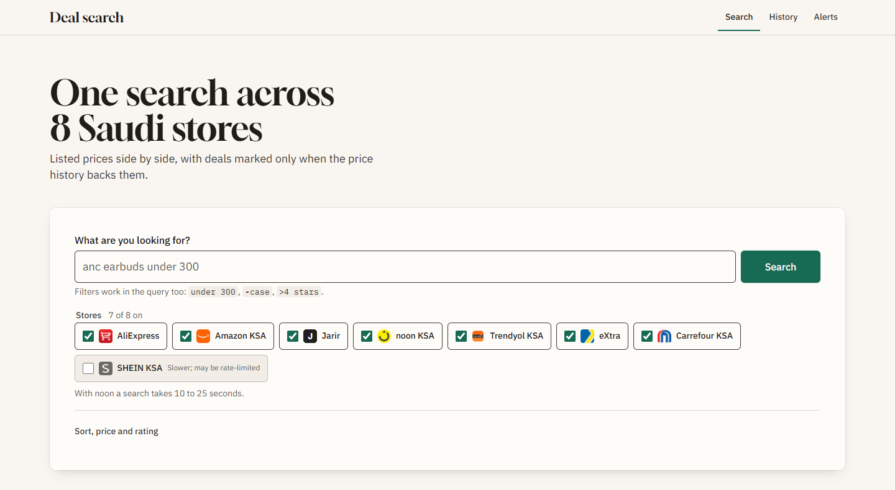
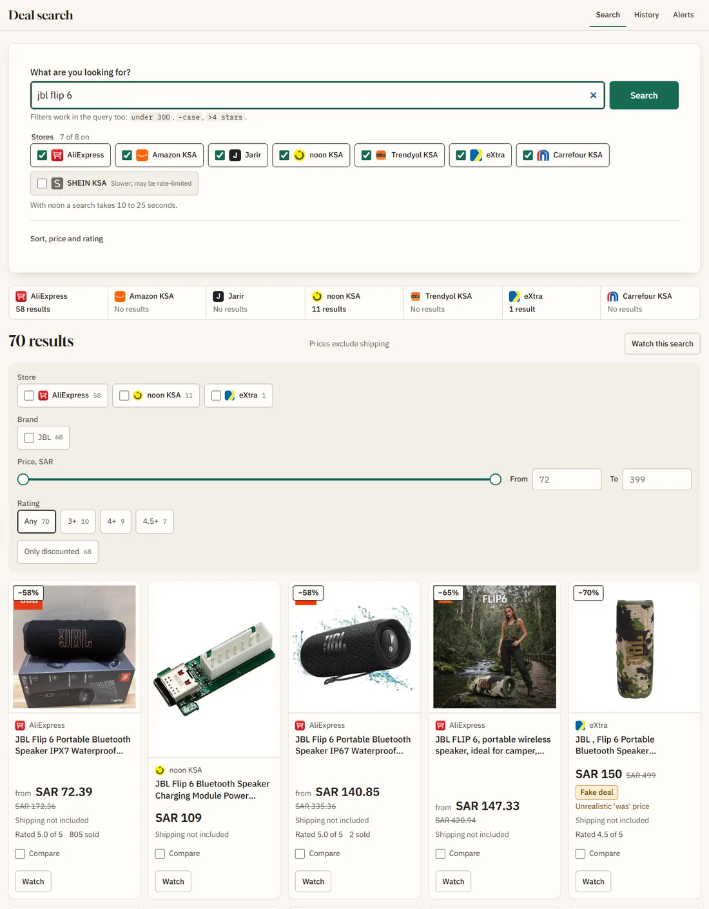
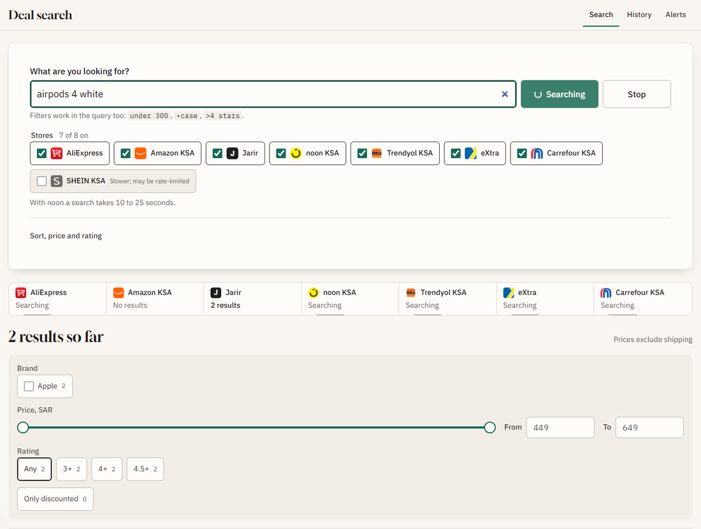
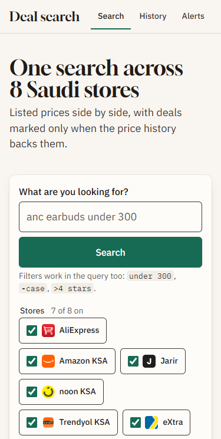
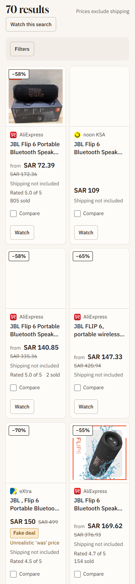
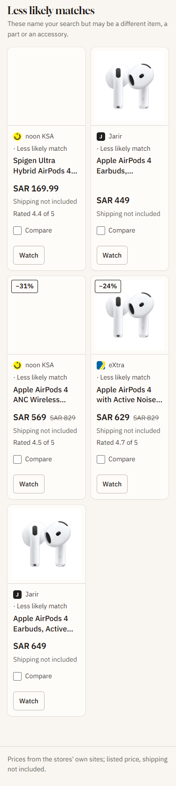
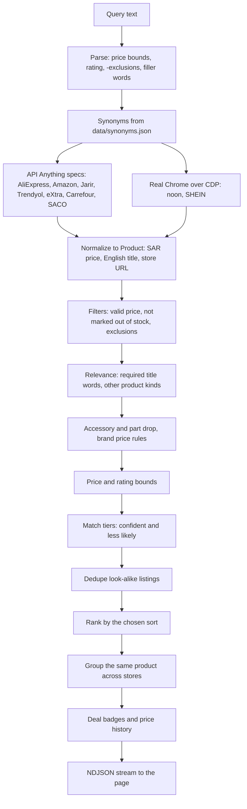

<div align="center">

# KSA Deal Search

**One search across nine Saudi online stores, with deals marked only when the price history backs them.**

[](https://github.com/drgoharyAI/ksa-deal-search/actions/workflows/ci.yml)
[](LICENSE)


[Quick start](#quick-start) ·
[Stores](#supported-stores) ·
[Features](#features) ·
[How it works](#how-it-works) ·
[Docker](#docker-deploy) ·
[Quality](#quality)



</div>

A self-hosted **Next.js 16 + TypeScript** app that searches nine Saudi online stores at once,
drops accessories and look-alikes, groups the same product across stores, and ranks the rest by
price, discount or deal score. All matching and ranking is rule-based: word rules plus statistics
of each result set. **No AI or LLM is involved.**

It is a personal-use tool, built to run on your own machine or a home server. Read
[Limitations and disclaimer](#limitations-and-disclaimer) before you run it.

<table>
  <tr>
    <td width="50%"></td>
    <td width="50%"></td>
  </tr>
  <tr>
    <td align="center"><sub>Results with filter chips and an honest "Fake deal" badge</sub></td>
    <td align="center"><sub>Streaming: stores fill in as they answer</sub></td>
  </tr>
</table>

## Supported stores

| | Store | id | How it is fetched |
| :-: | --- | --- | --- |
|  | AliExpress | `aliexpress` | API Anything spec, KSA / English / SAR cookie |
|  | Amazon KSA | `amazon-sa` | API Anything spec |
|  | Jarir | `jarir` | API Anything spec |
|  | noon KSA | `noon-sa` | Real Google Chrome, driven over CDP |
|  | Trendyol KSA | `trendyol-sa` | API Anything spec |
|  | eXtra | `extra-sa` | API Anything spec |
|  | Carrefour KSA | `carrefour-sa` | API Anything spec |
|  | SACO | `saco-sa` | API Anything spec (its server-rendered search page) |
|  | SHEIN KSA | `shein-sa` | Real Google Chrome, driven over CDP (off by default) |

<details>
<summary><b>API Anything specs and real Chrome over CDP</b></summary>

- **API Anything specs**: [api-anything](https://www.npmjs.com/package/api-anything) replays a
  learned HTTP search operation for each store (`api-specs/<id>.json`).
  `scripts/install-specs.mjs` (run before `dev` and `start`) copies `api-specs/*.json` into API
  Anything's local home and sets the AliExpress cookie for Saudi Arabia / English / SAR.
  `API_ANYTHING_LOCAL_ONLY=1` keeps it off the shared registry.
- **Real Chrome over CDP**: noon and SHEIN block plain HTTP clients and headless browsers, so the
  app starts your installed Google Chrome (headed, window off-screen, its own profile outside the
  repo) and reads results through Playwright `connectOverCDP`. Searches are serialized, spaced out
  and cached, and the app backs off when a store blocks. If Chrome is not installed, those stores
  show an error and the others still work.

The store list lives in `src/sites/registry.ts` (server) and `src/lib/stores.ts` (client);
`tests/lib/stores.test.ts` keeps them in sync. The Jarir icon is a plain "J" stand-in, not
Jarir's mark; see [public/stores/SOURCES.md](public/stores/SOURCES.md).

</details>

## Features

| | |
| --- | --- |
| **Streaming results.** Each store's results appear as it answers, with a live status per store (searching, results, no results, unavailable, failed). | **Cross-store grouping.** The same product at several stores becomes one card with one row per store, matched by model codes, brand, specs and variant words. |
| **Honest deal badges.** "Lowest in 30 days", "Below usual price" and "Fake deal": a claimed discount that the app's own price history, or the result set, does not support. | **Smart query parsing.** Price bounds (`under 300`, `50-150`), minimum rating (`>4 stars`) and exclusions (`-case`) are read from the query text. |
| **Relevance filtering.** Drops listings the store marks out of stock (SACO's branch-pickup-only listings stay, labelled "Branch pickup only", after the deliverable ones, with no deal badge or alert), and accessories, parts, books and other product kinds that share the query's words, and clones far below a model's usual price. Weaker matches go under "Less likely matches". | **Filter chips.** Store, brand, price range, rating and "only discounted", each with a live count. |
| **Compare.** A side-by-side table of 2 to 4 products with their parsed specs. | **Price history sparkline.** Every search records prices to a local SQLite file (`node:sqlite`); cards and watches show the trend. |
| **Telegram alerts.** Watch a product or a whole search; a background checker re-runs it on a schedule and notifies by Telegram (optional) and on the Alerts page. | **Search history and suggestions.** Re-run past searches, autocomplete from your history and from Amazon's and Jarir's public suggestions, and a "recently seen deals" home view. |

<table>
  <tr>
    <td width="33%"></td>
    <td width="33%"></td>
    <td width="33%"></td>
  </tr>
  <tr>
    <td align="center"><sub>Home, 375 px</sub></td>
    <td align="center"><sub>Results, 375 px</sub></td>
    <td align="center"><sub>Less likely matches, 375 px</sub></td>
  </tr>
</table>

### Search syntax

| You type | Meaning |
| --- | --- |
| `under 300`, `below 300`, `<300` | max price 300 SAR |
| `over 50`, `above 50`, `>50` | min price 50 SAR |
| `50-150`, `sar 50 - 150` | price range |
| `>4 stars`, `4.5+ stars` | minimum rating (inclusive) |
| `-wired` | drop titles containing the word "wired" |

Filler words (`best`, `cheap`, `for`, ...) need not appear in titles; the stores still get your
exact text.

## How it works

The UI is at `/`; the page calls `POST /api/search/stream`, and `POST /api/search` returns the
same result in one answer. A search runs through `src/lib/pipeline.ts`:



<details>
<summary><b>Pipeline details</b></summary>

1. **Parse** the query (`src/lib/query/`): price bounds, rating, `-exclusions`, filler words,
   synonyms from `data/synonyms.json`.
2. **Fetch** every selected store in parallel through its adapter (`src/sites/<id>/search.ts`):
   build the calls, run them (API Anything or Chrome), with per-store caches and back-offs.
3. **Normalize** each raw item to a `Product` (SAR price, English title, store URL); unreadable
   items are dropped and a store whose items are all unreadable reports `error`.
4. **Filter**: valid price, exclusions, price and rating bounds (`src/lib/filters.ts`).
5. **Match** (`src/lib/match/`): required title words, accessory and part detection, other
   product kinds, brand/model price rules, title-structure and confidence scoring into confident
   and "less likely" tiers.
6. **Dedupe** look-alike listings, then **rank** within each tier by the chosen sort
   (`src/lib/rank.ts`).
7. **Group** the same product across stores (`src/lib/match/group.ts`).
8. **Record** price observations and attach deal badges (`src/lib/insights.ts`); save the search
   to history.

Each store gets a status: `ok` (including an empty answer), `blocked` (the store refused; the app
backs off) or `error`.

</details>

<details>
<summary><b>Streaming protocol and API routes</b></summary>

`POST /api/search/stream` takes the same body, guard and input errors as `/api/search` and
answers NDJSON, one event per line:

- `{"type":"store","store","state"}` first for every store (`searching`);
- then per answer the store's line (`ok` with `count`, `empty`, `unavailable` with `retryAt` when
  known, or `failed`) and a `{"type":"results",...}` event with the whole view over the stores
  answered so far, in the `/api/search` body's shape;
- then `{"type":"done"}`.

The last `results` event equals the `/api/search` answer. The pipeline is split for this into
`prepareSearch`, per-store `fetchSite` and a pure `assembleResults`. History, observations and
seen products are recorded once, at the end; a client that goes away stops the search (queued
store calls are skipped) and nothing is recorded. The page falls back to `/api/search` if the
stream fails before any event. Protocol: `src/lib/search-stream.ts`.

Other routes: `GET /api/suggest` (Amazon and Jarir public autocomplete), `GET /api/discover`,
`/api/history`, `/api/watches`, `/api/alerts`, `GET /api/health`. All API routes reject
cross-site requests and hosts that are not loopback or listed in `APP_HOSTS`
(`src/lib/request-guard.ts`).

</details>

## Quick start

Requirements: Node.js 22.13 or newer (CI uses 24), and Google Chrome for noon and SHEIN.

```bash
npm i
npm run dev                  # http://127.0.0.1:3000
npm test                     # unit and fixture tests (vitest), offline
npm run build && npm start   # production build
```

`dev` and `start` listen on `127.0.0.1` only. Do not remove `-H 127.0.0.1` from the scripts
unless you mean to expose the app.

## Docker deploy

```bash
cp .env.example .env         # then set APP_HOSTS (and Telegram, if wanted)
docker compose up -d --build
```

`Dockerfile` and `docker-compose.yml` build a standalone Next.js server with Google Chrome on a
virtual display (Xvfb) for noon and SHEIN, and a data volume for SQLite and Chrome profiles.
Optional compose profiles add Caddy (LAN HTTPS) or `cloudflared` (Cloudflare Tunnel).
`scripts/deploy.sh` deploys the committed tree to the VM over SSH; `scripts/backup.sh` backs up
the data volume (database and Chrome profiles) on the VM.

See [docs/DEPLOY.md](docs/DEPLOY.md) for the VM setup, Chrome sandboxing, backups and
troubleshooting.

## Configuration

Local development needs no configuration. Optional settings go in `.env.local` (development) or
`.env` (Docker); both are gitignored. [`.env.example`](.env.example) lists the Docker keys.

| Key | Meaning |
| --- | --- |
| `APP_HOSTS` | Hosts the browser may use to reach the app, comma-separated `host[:port]`, exact match. Loopback is always allowed. |
| `TELEGRAM_BOT_TOKEN`, `TELEGRAM_CHAT_ID` | Telegram price alerts (optional). The token is server-only and never logged. |
| `ALERT_CHECK_HOURS` | Hours between price-alert checks (default 6, minimum 0.25). |
| `NODE_ENV` | `production` in Docker. |
| `CADDY_HOST` | With the `https` compose profile: the LAN name Caddy serves. |
| `APP_BIND` | IPv4 address the published ports bind to (default `0.0.0.0`). |
| `COMPOSE_PROFILES`, `TUNNEL_TOKEN` | Optional Cloudflare Tunnel (`tunnel` profile); the token goes in `.env.tunnel`. |
| `API_ANYTHING_HOME`, `API_ANYTHING_LOCAL_ONLY` | API Anything home (default `./.aa-home`) and local-only mode (default `1`). |
| `NOON_PROFILE_DIR`, `SHEIN_PROFILE_DIR`, `CHROME_PATH` | Chrome profile folders and Chrome binary override. |
| `DEAL_SEARCH_DB` | SQLite file for history, prices and alerts (default under `%LOCALAPPDATA%\deal-search` or `~/.local/share/deal-search`). |

<details>
<summary><b>Telegram setup and matching word lists</b></summary>

Telegram: create a bot with @BotFather, send it a message, read your chat id from
`https://api.telegram.org/bot<TOKEN>/getUpdates`, set both keys, restart, then use "Send test
message" on the Alerts page.

The matching word lists are in `data/` (synonyms, match aliases, accessory words, part words,
other product kinds, brands). Restart after editing, then re-run the eval.

</details>

## Quality

```bash
npm run qa   # lint, strict lint (typescript-eslint, security, ReDoS), typecheck, tests, knip
```

CI ([.github/workflows/ci.yml](.github/workflows/ci.yml)) runs typecheck, lint, tests and build
on every push and pull request to `main`. External scanners (Semgrep, gitleaks, osv-scanner, npm
audit) and the lint policy are described in [docs/QA.md](docs/QA.md).

**Eval harness.** The eval replays recorded store answers (`eval/recorded/<store>/<query>.json`)
through the real pipeline, so matching changes are measured offline. Latest numbers, from
[eval/RESULTS.md](eval/RESULTS.md):

| Query set | precision@10 | accessory@10 | wrong-model@10 | recall |
| --- | --- | --- | --- | --- |
| tuning (15) | 99% | 1% | 0% | 92% |
| holdout (8) | 99% | 1% | 0% | 87% |
| holdout 2 (6) | 100% | 0% | 0% | 90% |
| holdout 3 (6) | 82% | 3% | 5% | 90% |
| holdout 4 (5) | 90% | 0% | 6% | 90% |

Cross-store grouping, on held-out queries: 100% merge precision (no wrong merges) at about 54%
merge recall. Metric definitions, misses and every tuning round are in
[eval/RESULTS.md](eval/RESULTS.md).

<details>
<summary><b>Eval scripts</b></summary>

| Script | Purpose |
| --- | --- |
| `node scripts/eval.mjs [--queries "a\|b"] [--top N]` | Replay and score precision@10, accessory@10, wrong-model@10, recall; writes `eval/last-run.json`. Offline. |
| `node scripts/eval-groups.mjs` | Score cross-store grouping against `eval/groups-gold.json` and `eval/groups-adversarial.json`. Offline. |
| `node scripts/eval-record.mjs` | Record new store answers. Live traffic: slow, one request at a time; use sparingly. |
| `node scripts/eval-dump.mjs` | Dump recorded products to TSV for labelling (`eval/LABELING.md`). |
| `node scripts/eval-group-candidates.mjs` | List candidate pairs for grouping labels. |

Query sets: `eval/queries.json` (tuning) and `eval/queries-holdout*.json` (held out). Keep a
change only when no set gets worse.

</details>

## Project structure

<details>
<summary><b>Folders</b></summary>

```text
app/            Next.js routes: pages (/, /history, /alerts) and API routes
src/lib/        pipeline, query parsing, matching, ranking, insights, alerts, db
src/sites/      one adapter per store, plus the shared Chrome/CDP driver
src/eval/       replay and metrics used by the eval scripts
api-specs/      API Anything search specs per store
data/           matching word lists
eval/           recorded store answers, labels, gold groups, results
scripts/        install-specs, eval, deploy and backup scripts
tests/          vitest unit, route and fixture tests
docker/         entrypoint, Caddyfile, Chrome seccomp profile
docs/           DEPLOY, QA, DESIGN and planning notes; README screenshots in docs/images
public/stores/  store icons (see SOURCES.md)
```

</details>

<details>
<summary><b>Adding a store</b></summary>

1. Learn the store's search operation with API Anything in a scratch home and check it returns
   English titles and SAR prices for Saudi Arabia.
2. Save the spec as `api-specs/<id>.json`.
3. Write `src/sites/<id>/search.ts` (`searchCalls`, `normalizeSearchItem`) with fixture tests
   under `tests/sites/`.
4. Register it in `src/sites/registry.ts` and `src/lib/stores.ts`.
5. Record and label a few eval queries for it.

</details>

## Roadmap

The "Souq Ledger" redesign ([docs/DESIGN.md](docs/DESIGN.md): warm paper, charcoal ink, one
palm-green accent) runs in six phases. U1 (design system, app shell, homepage) and U2 (streaming
search and store status) are done. Still to come:

- [ ] **U3**: results layout, filters and cards (desktop filter sidebar, mobile bottom sheet)
- [ ] **U4**: compare, designed for mobile
- [ ] **U5**: discovery features (recently viewed, favourites, shareable result URLs)
- [ ] **U6**: responsive, accessibility, QA and deploy

## Security

There is **no login, no user accounts and no rate limiting, by design**. Run it on your own
machine, a trusted network, or behind a private tunnel or access layer. Anyone who can reach the
app can run searches from your IP and read your history and watches. See
[SECURITY.md](SECURITY.md) for what the app does to limit exposure and how to report an issue.

## Limitations and disclaimer

- **Personal-use tool.** It sends ordinary search requests from your own IP, at a low rate.
  Whether that is allowed by each store's terms of service is your responsibility. Respect those
  terms, and do not use it for bulk scraping or commercial data collection.
- **Prices are listed prices** from search results, not checkout prices. Shipping, fees and
  coupons are not included. "Was" prices, and so discounts, come from the stores and may be
  inflated.
- **Fragile by nature.** Stores change their pages and APIs and may block automated clients; a
  store then shows `error` or `blocked` until its adapter is updated. noon and SHEIN are the
  slowest (a cold Chrome start takes 15 to 20 s).
- **No affiliation.** This project is not affiliated with, endorsed by or sponsored by any of the
  stores. Store names and logos are trademarks of their respective owners; the icons in
  `public/stores/` are used only to identify each store (sources in
  [public/stores/SOURCES.md](public/stores/SOURCES.md)).

### Privacy

Search history, price observations and alerts stay in a local SQLite file. Recent searches stay
in your browser's `localStorage`. Query-box text (2 to 80 characters) is sent from the server to
Amazon's and Jarir's public suggestion services, without cookies. Store requests go straight from
your machine to the stores.

## License

[MIT](LICENSE)
